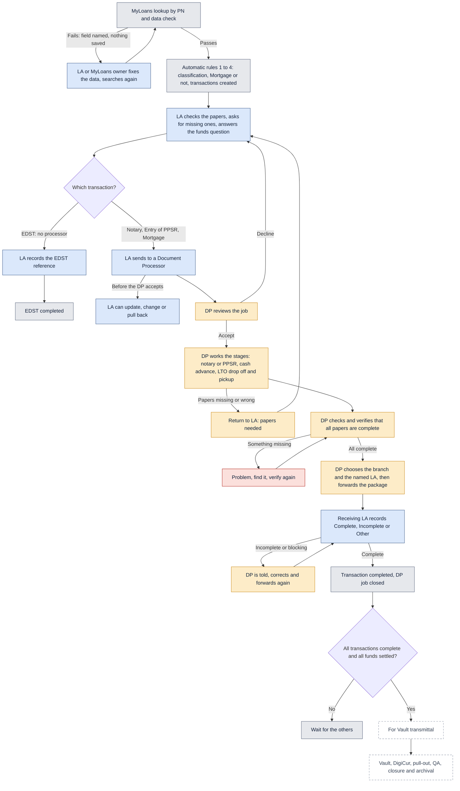

# Big picture

How a released loan moves from the MyLoans lookup to the vault gate.

Last updated: 8 November 2026 (PHT)

See the [colour key](README.md#colour-key).

- EDST is done by the LA alone. Notary, Entry of PPSR and Mortgage go to a Document Processor.
- At the LTO the DP drops off the papers, picks them up, then checks and verifies that every paper is back and complete.
- Only then does the DP forward the package. **The DP chooses the branch and the named LA. Forwarding is never automatic.**
- The loan reaches the vault stage only when every transaction is complete and all funds are settled.

[Back to the workflow index](README.md)
