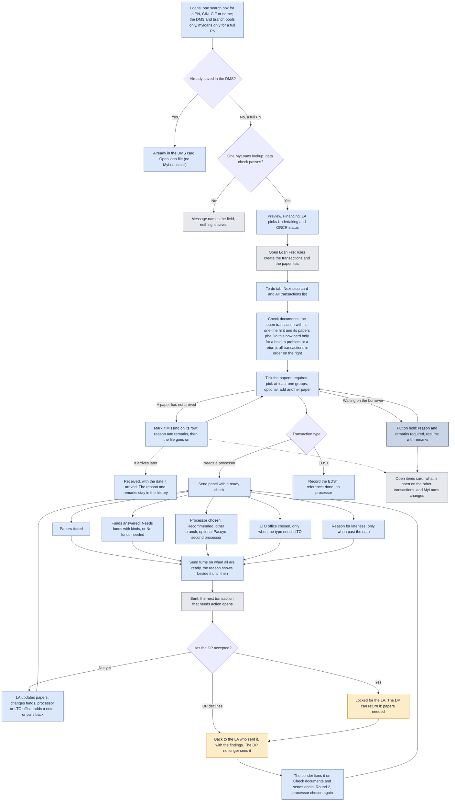
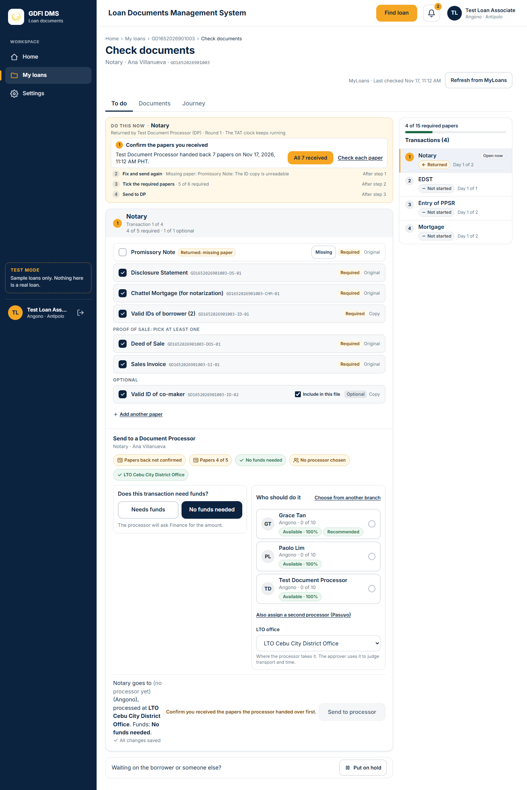
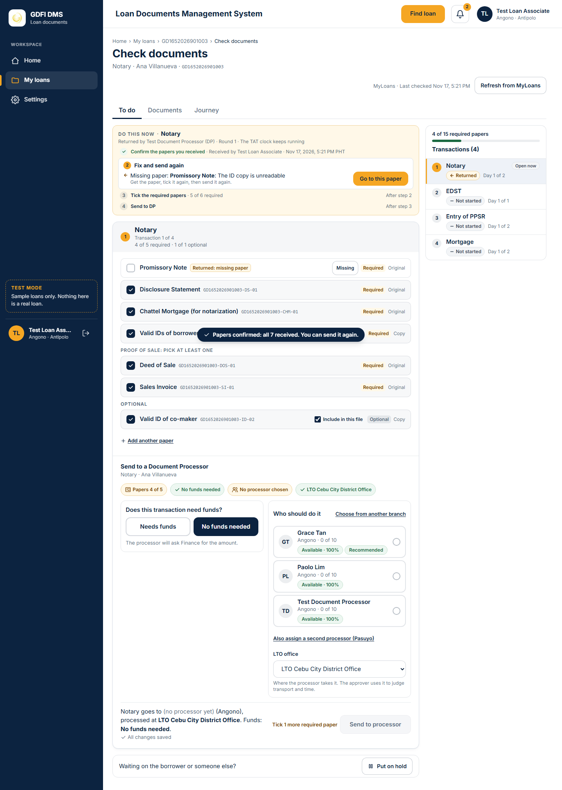
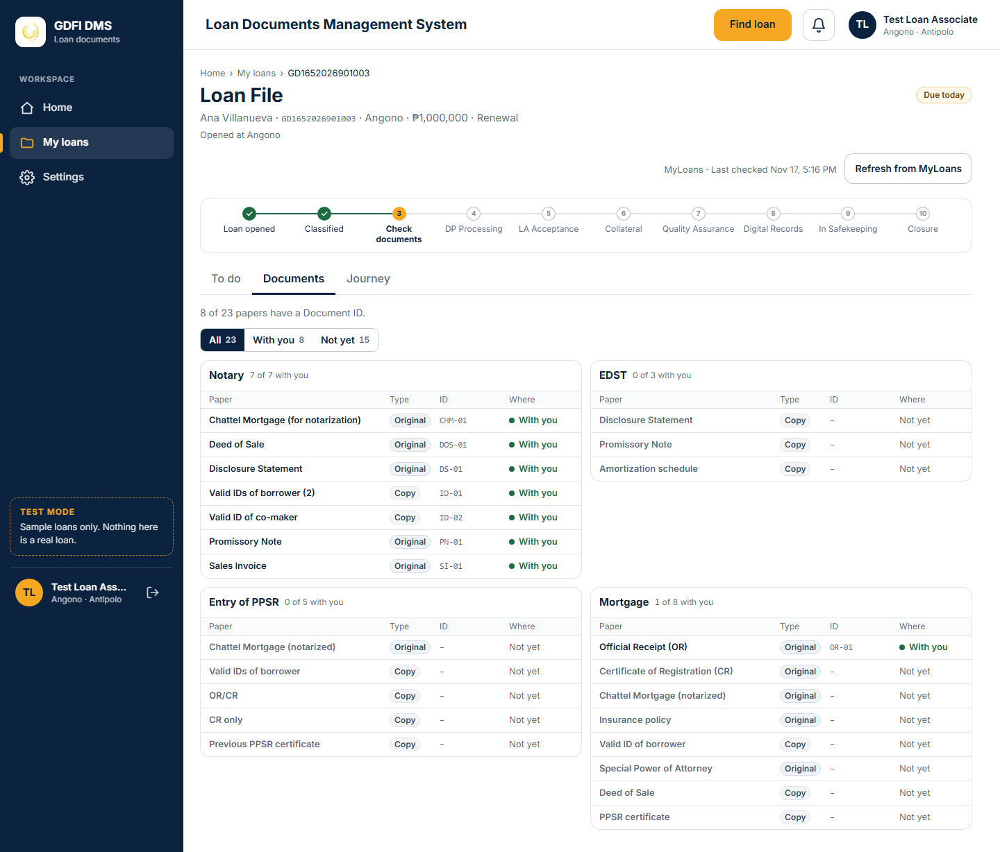
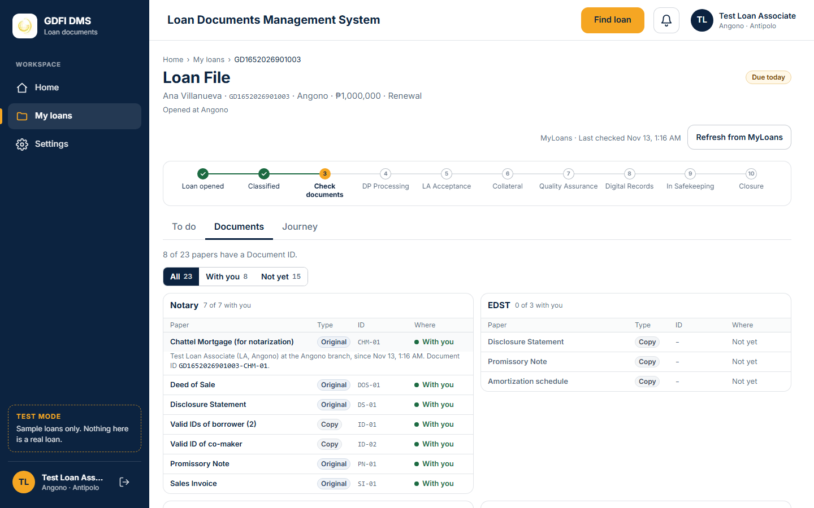
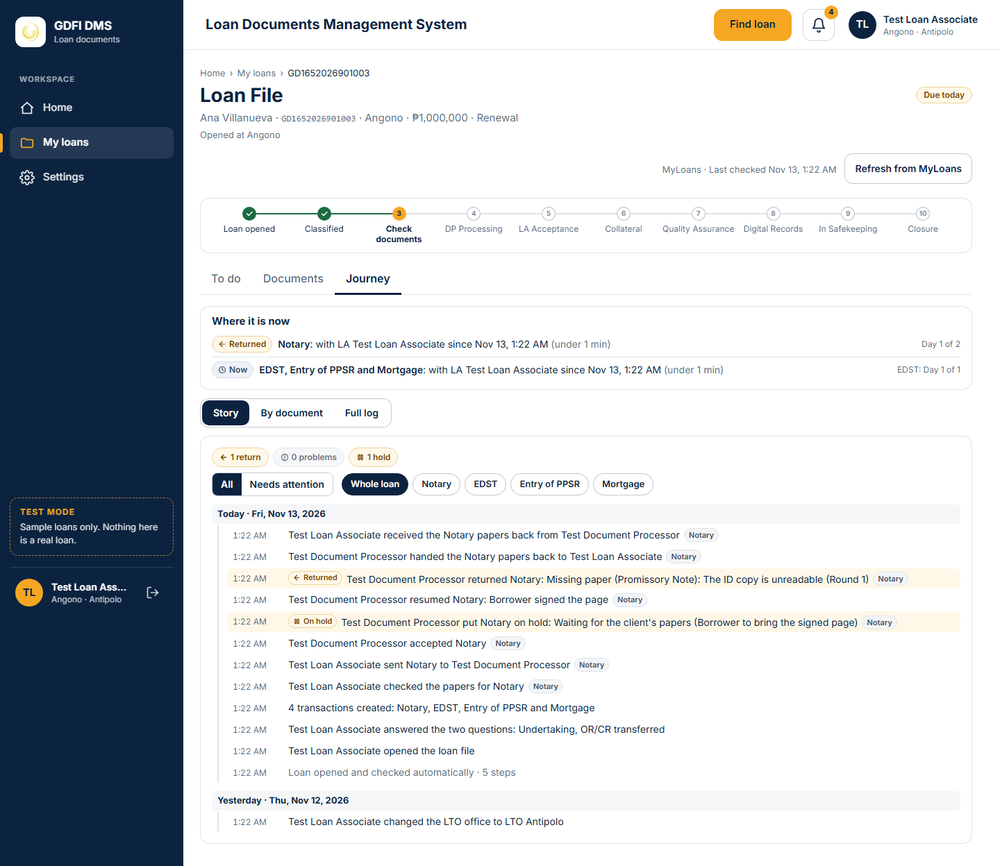
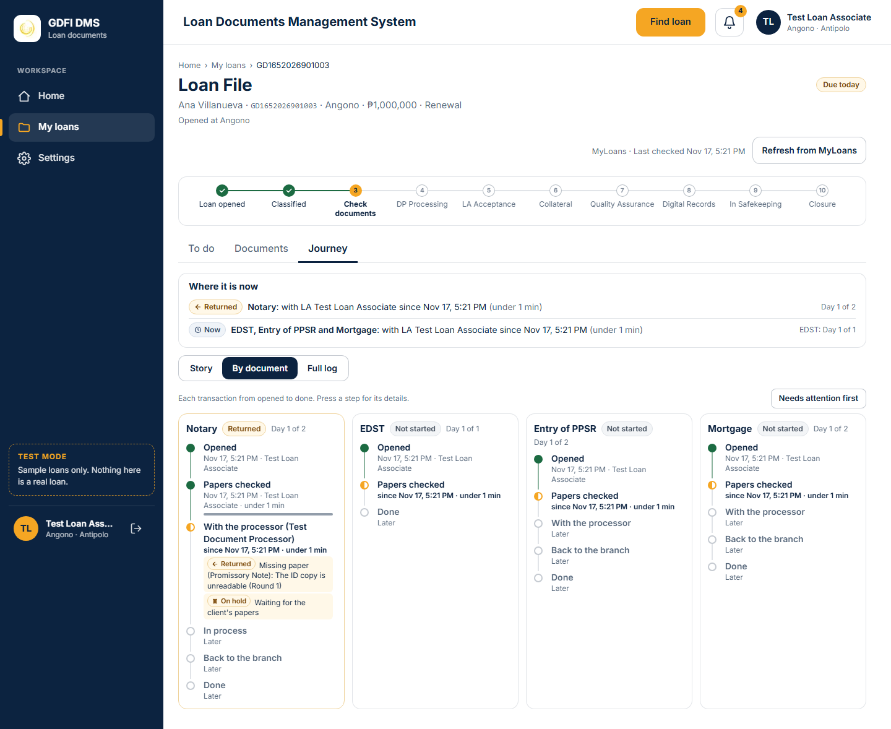

# The Loan Associate

What the Loan Associate does, from Find loan to Send and the changes allowed before the DP accepts.

Last updated: 27 November 2026 (PHT)

See the [colour key](README.md#colour-key).

- **Loans: one table and one smart search (D-059).** Every role has one Loans page (it replaced My loans, the read-only Loans list and Find a loan; `/search` and the header's Find loan open it with the box focused). No tabs: Status chips (Needs action, Not yet in DMS, On hold, Problems, Archived; none chosen: every open loan) and a Filters button (Branch, Assigned to: Anyone / Me / Branch pool, Late only), each option with its count; late first, then the soonest due; sort by Borrower, Branch, Released on, Amount or Due; 25 or 50 a page; everything in the address. The rows are the loan files of the user's branches and, only in a search or with the Not yet in DMS filter (D-060), the released loans still in the branch pools, marked with the badge "myloans · Not yet in DMS". Every row has one action, **View details** (the rows themselves are not links): the loan file, or for a loan not yet in the DMS its **loan preview** (`/loans/preview/<PN>`): what MyLoans says now (CIN, branch, product, loan type, classification, amount, release date, status in MyLoans), how long it has waited in the pool, **Open loan file** (for people who may open loan files) and **Refresh from myloans**. There is no Accept for these loans, on Loans or on Inbox › Branch pool; Open loan file makes the loan file the opener's, starts their TAT and takes the item out of the pool. Another branch's preview is not found; a loan no longer released in MyLoans shows the reason card and no Open. **The search box never sends a name or part of a PN to MyLoans:** it searches the DMS loan files and the pool items of the user's branches (part of a PN, part of the name, the exact CIN or CIF, a paper's Document ID, a branch code), as you type (from 3 characters, after a short pause) and on Enter or **Search**. Only a full, valid PN that is neither a loan file here nor in a pool is looked up in MyLoans, once, and logged: **Found in myloans** shows the preview below with **Open loan file**, or the reason (cancelled, replaced, not a released loan, not found, outside your branches, MyLoans busy). A full PN already in the DMS is its row in the table (logged as already in the DMS; an old copy is refreshed in the background). In the search the PN may be typed with or without GD (the 13 digits alone, for example 1012026900001, get GD put in front), and part of a PN may have spaces, dashes or dots; imports and the PN format setting still need the GD. One loan file per PN: when two people press Open loan file on the same new PN at once, one file is made and the second sees "Already opened by <name> at <time>. Nothing else was created." with **View it** (D-060). The PN is checked first (Settings, System, PN format: GD + branch code + year + 9 + running number, for example GD1012026900001; spaces, dashes and dots are removed): a wrong PN shows "This does not look like a PN. Example: GD1012026900001" and the wrong part, and is never sent to MyLoans. Found in myloans is one compact card with the loan, the two questions when the loan is Financing and **Open loan file**, which stays disabled until both are answered. Nothing is said twice: the card shows the borrower and the PN on the left and, on the right, the MyLoans status by its name ("Loan Released") and the badge "myloans · Not yet in DMS" (D-060); an amber chip appears only when something is not fine (for Admin, "Details incomplete" with the data-check sentence), never an "all good" chip. Then the details by name only: amount released, released on, loan type, product, branch, area, division and company, then (D-060) the CIN, the classification ("(classified by default)" when no keyword matched) and the status in MyLoans. Each question is two separate, equal-width buttons (Undertaking / Non-Undertaking, Transferred / Untransferred; a radio group: arrow keys move, Space chooses); nothing is chosen at the start, the chosen one fills navy with a check, and choosing it again keeps it. Once nothing is left to answer (a Refinancing loan: at once), **What will be set up** lists the transactions and the rules that apply by name, never by number ([Rule names](09-status-and-open-questions.md)). Beside a disabled **Open loan file** one line names the missing answer ("Choose the OR/CR answer"); once it can be pressed, the line says "Nothing is saved until you open the loan file." Codes and IDs are not shown there ([field map](../myloans/field-map.md)). A message (not in MyLoans, outside your branches, details to fix) is one short line with the PN and Try again. A PN with no loan in MyLoans says once "No loan with this PN was found in MyLoans." **Only MyLoans status 12 (Loan Released) is accepted** (one rule, `lib/myloans/status.ts`; no setting). A loan in the user's branches with any other status shows a **status card**, never a loan file, laid out like a released loan: the borrower and the PN on the left, the MyLoans status by name (amber) and MyLoans on the right, the same eight details (Released on says "Not released yet" when there is no release date), and one line "This loan is not released yet." (statuses 1 to 11, 13 and 49), "This loan was cancelled in MyLoans." (14) or "The DMS does not accept this status." (any other), with "Only released loans can be opened in the DMS. Nothing was saved." and Try again; no Open button, nothing saved, and no further MyLoans call (the one lookup is reused for its short cache time). Statuses 15 to 19 are disbursement-check records, not loans: they show the "No loan with this PN was found" message. The branch check comes first: outside the user's branches the loan card is never shown, only "This loan is outside your branches." with the PN and the branch only (never the borrower's name, since PNs are easy to guess; decided 12 November 2026) and how to get access ("ask your Admin to add this branch to your access"; there is no in-app request) Nothing is saved until Open loan file. The Loan File shows the PN as stored and "Opened at {branch}" under it, the branch name only ("..., now at ..." when MyLoans moved the loan). Its **Loan at a glance** (D-062: one compact card, no open / close) shows what people need: Type, Mortgage needed, OR/CR, Send by, CIN, CIF, Area, Opened (when, by whom) and **Why this was set up** (the rule's name and its reason, for example "Mortgage needed · This is a New loan of ₱500,000 or below."; loan files opened earlier show the same words). People who manage the myloans link (Admin) also see the **myloans codes** (source loan ID, product code, branch, area, division and company IDs, status ID, active, retrieved and updated times). The "Something wrong?" row opens Report a problem (the whole row, with a chevron).
- **Released loans waiting in the branch pool (D-053).** The sync puts every loan released in MyLoans and not yet opened in the DMS in the branch's LA pool (from the branch-pool cutoff). An LA opens it from Inbox, Branch pool (D-063: its row opens the loan preview in the Inbox's details panel, with Open loan file and Refresh from myloans) or from Loans, Not yet in DMS, with **View details**, then **Open loan file** (D-060: no Accept; opening takes it out of the pool); the waiting time counts from when it entered the pool, shown as "In the branch pool since Nov 24 · 2 working days", and it never starts before the loan's release date (the app and the database both move an earlier arrival up to the release date).
- **MyLoans changes are Open Items (D-053).** When MyLoans changes a field of a saved loan (amount, loan type, product, release date, branch, status, or the borrower's name, CIF or CIN), the loan keeps the DMS value and the change waits as an Open Item for the branch's approvers (the Open Items page). Nothing is blocked, except when MyLoans says the loan is no longer Released: then Send, Forward and new cash wait until the status item is decided. A loan with no borrower name at all in MyLoans cannot be opened ("MyLoans has no borrower name for this loan. Ask the MyLoans team to complete it."). When MyLoans is too busy (the hourly limit or the circuit breaker), Find loan says "MyLoans is busy, please try again in a few minutes."
- **The loan summary card (D-062)** is the same on every loan file tab: the borrower's name with the status in myloans ("Loan Released"), the due badge and **Refresh from myloans** (an icon; its tooltip says when myloans was last checked) at the right of its line, the PN with Copy under it ("Opened at Antipolo, now at Angono" shows there only when myloans moved the loan), then Product · Loan type (New or Renewal) · Amount · Released on · Branch · Assigned to. On To do, Documents and Journey it is a card at the top of the page, with the stepper under it (no separate step heading); on Check documents it is at the top of the transactions card (the side panel from 1280 px, above the strip on smaller screens) and the page's heading is "Check documents".
- Check documents shows the open transaction on the left (its header has the one-line hint of what to do now and its progress, once) and all transactions, in fixed order, on the right from 1280 px (a strip above it on smaller screens) (see [What the loan file shows first](#what-the-loan-file-shows-first)).
- Nothing is pre-selected for funds: the LA must answer. The LTO office and the late reason appear only when they apply. The Send panel ends with a two-line summary (where it goes and the LTO office; then the funds) and the one Send button; while Send is locked, one line under it names the first thing missing ("Tick 5 more required papers"), and pressing those words goes there (D-062).
- Before the DP accepts, the LA can update papers, change funds, processor or LTO office, add a note, or pull back. After accepting, only the DP can return it.
- A Decline (before accepting) or a Return to LA (after) goes back to the specific LA who sent it, never to another LA of the branch: it is on that LA's Home ("Sent back to you"); on Check documents the "Do this now" card says it once: the findings, the DP's name and the round. Sending again starts a new round; nothing is pre-selected.
- While a transaction is on hold it is locked for everyone (see [Locked](01-glossary.md)); only the hold owner can resume it.
- The Open items card on Check documents lists what is open on the other transactions of the loan file and MyLoans changes. What the "Do this now" card already says for the open transaction is not repeated there; when nothing is left, the card is not shown. A "Sent back to you" or "Waiting for papers" row reads top to bottom (the badge, the transaction, what was found or asked, then who and the date and time in PHT, so the turnaround time can be read exactly) and the whole row opens it (Open, or Show paper for a missing paper). The right column scrolls with the page. On the dashboard and the Updates page it is unchanged.

## Missing papers with reasons

A missing paper no longer blocks the file (confirmed with the users, 10 November 2026). The rules:

1. **Per paper.** The reason and remarks belong to that paper, not to the file.
2. **Required papers** are Present (ticked) or **Missing**. Choosing **Mark as missing** in the row's "⋯" menu (D-062) opens a compact box right under it (no pop-up): the **Reason** as one-tap chips (Settings, Missing paper reasons; the focus goes to them) and one **Remarks** line that grows as you type, with **Save** beside it (under it on a phone). Remarks are 5 to 500 characters, always required, also for "Other"; the hint says how many characters are left, and the count shows only near 500. Enter saves, Shift+Enter is a new line, Esc cancels an edit. Saved, it folds to one line: the reason chip, the remarks, who and when, and **Edit**. The row is red "Missing, remarks needed" until they are saved, then amber "Missing, with remarks".
3. **Optional papers** have an **Include in this file** tick. Off: the row stays quiet and nothing expects the paper. On (or ticked Present): it behaves exactly like a required paper.
4. **Send** stays locked while any expected paper is Missing without saved remarks, and says which ("Add remarks for: Deed of Sale, Valid ID"). The server refuses the same.
5. The processor cannot return the file for a paper already Missing with remarks; it goes through as an exception (see [The DP job](04-dp-job.md)).
6. Through the **vault gate** the file is "Complete with exceptions" until every missing paper is Received.
7. **Received**: the LA (papers:receive_late, also Admin) marks it Received with the date it arrived (not in the future, not before it was marked). The reason and remarks stay. With the last one the flag clears.
8. **Remarks are never silently changed.** Every save and edit is kept in the paper's history (who, when, old and new text). Once the transaction was sent, a missing paper cannot be un-marked or its remarks removed: it ends only when Received. Before the first send, "Not missing" or ticking it Present takes the mark back (also kept in the history).
9. The turnaround time never pauses for a missing paper.
10. No alerts and no emails: the Loan File shows a short **Missing papers** row near the top (only when there is one), and Monitoring has the **Has missing papers** filter.

The old "Ask for missing paper" pop-up and its problem card are gone; the problem card now shows only problems raised by others (the processor's return, MyLoans changes, the LA's "Wrong details" or "Something else").

## What the loan file shows first

On Check documents, the open transaction's header says the one thing to do now in one line (D-062): "Tick the 5 required papers, then send to DP", "Tick the 3 remaining required papers, then send to DP", then "All required papers are ticked: choose a processor below and send it to DP." (for EDST "record the EDST reference", for a custom transaction "mark it as done"), with the progress once under it ("0 of 5 required · 0 of 1 optional" and a thin bar). The button is the Send panel's own (or Mark EDST done, Mark as done): never a second one. When the step needs its own controls (steps 1 to 4 below), the "Do this now" card at the top of the left column holds them and the header's line points to it. Each fact is said once. The steps come from one place (`getNextSteps` in `lib/workflow/next-steps.ts`), which also gives the status word in the Transactions list, the marker on a returned paper and what the Open items card leaves out, so they always agree. Only the steps that apply are shown; the first one not done is open, the others are one grey line ("After step 2") or a green tick when done.

1. **On hold**: the hold reason, who put it on hold, and Resume for the hold owner only (others see who must resume it). The transaction stays locked until then.
2. **Problem to fix**: the problem, who raised it, and its usual action.
3. **Confirm the papers you received**: after a Return to LA with papers handed over. "All 7 received" confirms them in one click; "Check each paper" opens the list of every paper, each set to Received, so one that did not arrive can be marked Not received (a problem is raised for it, as before).
4. **Fix and send again**: returned or declined by the DP. The findings are shown here once, with the paper named in bold and "Go to this paper". The paper's row in the checklist has one small marker ("Returned: missing paper"). It comes after step 3 because the paper must be back in hand before it can be fixed, and Send stays locked until the papers are confirmed.
5. **Waiting for a paper**: an older missing-paper request (not the DP's own return): which paper, who asked, "Show paper". New ones are not made: the LA marks the paper Missing on its row instead.
6. **Tick the required papers** (the header's hint, no card): "4 of 5 required" (every paper of the file: a missing paper lets the file go on once its remarks are saved). A missing paper is never counted as received: while one is missing, the step, the loan file header, its progress bar, the transaction card and the Send check read "4 of 5 received · 1 missing with remarks", and the bar shows received papers only.
7. **Send to DP** (the header's hint, no card): the Send panel below, which keeps its own ready check and the one Send button. Work without a processor ends with EDST or Mark as done instead.

Each paper is one compact row (about 36 px; 44 px to tap on a phone): the tick box, the paper's name and its chips right after it (Received, Missing, Requested, Required or Optional, Original or Copy), and at the end Include in this file (optional papers) and a quiet **"⋯" menu** with **Mark as missing** (or Not missing before the first send). The card is soft amber for a returned transaction, soft red for a problem, soft grey-blue for a hold, and white with a plain border for normal work. The Transactions list shows one status word per transaction (On hold, Problem, Returned, Missing paper, Not started, Needs papers, Ready to send, Sent to DP, In progress, Coming back, Done) and the day count in grey. On tablet and phone the transactions become a strip under the card; only the strip scrolls sideways.

## Documents tab

The Documents tab lists every paper of the loan file, one compact card per transaction, in the usual order. It only shows; ticking papers stays on Check documents. There is no label printing (labels were removed on 11 November 2026: they are not used in the LA and DP flow).

- At the top: "8 of 23 papers have a Document ID" and the filter **All · With you · Not yet** with its counts. The filter is kept in the address (`?papers=with-you`), so a refresh keeps it; "Not yet" with nothing left says "All papers are with you."
- Each card: the transaction and "7 of 7 with you".
- One line per paper: Paper, Type (Original or Copy), ID (the short Document ID, for example `CHM-01`; the full one is in the tooltip and the details), Where (**With you** with a green dot, **Not yet** in grey, or a short phrase such as "At DP 1" or "On the way"). "Not yet" lines are dimmed but keep their word.
- Press a line (or Enter) to open its details: who has it, where and since when, in Philippine time ("Test Loan Associate (LA, Angono) at the Angono branch, since Nov 10, 9:29 AM"), and the full Document ID. The same sentence is the line's tooltip.
- Two cards per row when the page is wide enough (1440), one column on a tablet, and on a phone collapsible cards (the ones with papers in hand open) with each paper on two lines.

## How to read the Journey

The Journey tab of the Loan File reads the same record three ways. Nothing is changed by reading it; the TAT clock never pauses.

- **Where it is now** (always on top): one line per place. Transactions in the same place and state share a line ("All 4 transactions: with LA 1 since Nov 9, 11:54 PM (7 h 30 min)"); one in another place or state gets its own line. Each line has one status pill (Now, On hold, Problem, Returned, Done) and the day count in grey ("Day 1 of 2", "Due today", or the late days in red). A role word and a name are said once ("With LA 1", never "With LA LA 1").
- **Story** (opens first): what happened, newest first. Each day is a date row ("Today · Tue, Nov 10, 2026", "Yesterday · Mon, Nov 9, 2026", then "Fri, Nov 7, 2026"); its events sit under it, each with its time (PHT) and one sentence ("DP 1 returned Notary: the ID copy is unreadable (Round 1)"), with the transaction pills. The same action by the same person in the same minute on several transactions is one line. Automatic steps are one grey line at the end of their day ("Loan opened and checked automatically · 5 steps"); they are listed in the Full log under **Show system steps**. Returns, declines, holds, problems and missing paper carry their word and a soft tint; the counts at the top are soft badges in the same colours ("1 return", "0 problems", "1 hold", "1 missing paper"; grey at 0), and pressing one shows only those lines. Filters: **All**, **Needs attention**, and **Whole loan** or one transaction (there is no "Mine"; an old link with it shows All). The Journey shows to everyone who can open the loan file.
- **By document**: one column per transaction (two per row on a tablet, a card per transaction on a phone, the ones that need attention open). Each goes Opened, Papers checked, With the processor (name), In process (only with stages), Back to the branch, Done: a filled dot when done (time, who, and a thin bar for the time it took), a gold half dot for now ("since Nov 9, 11:54 PM · 7 h 30 min"), an empty dot for later. Holds, returns, declines, problems, missing paper and funds show on the step they affected, with the Round for a return. Press a step to see its details. **Needs attention first** moves those columns to the front.
- **Full log**: the ten phases with every step, closed under "Full audit log". Search, **Who** (LA, DP, Finance, System), and the switches **Show system steps** and **Show not applicable** (both off at first). Each step says one phrase ("Done in 4 min · Nov 10, 8:42 AM", "Open since ..."); the target is named only when it is late or due today. Step numbers (1.1, 3.6) appear here only. "Papers: who has them" lists each paper's custody trail.

The choice of view and the filters are kept in the address, so a refresh keeps them.

[Back to the workflow index](README.md)
