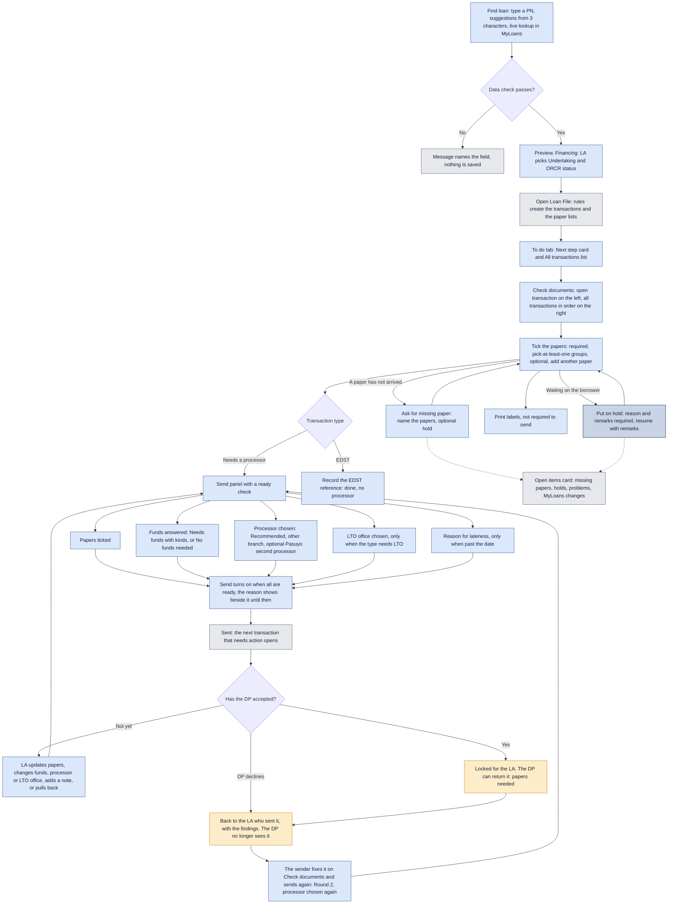

# The Loan Associate

What the Loan Associate does, from Find loan to Send and the changes allowed before the DP accepts.

Last updated: 8 November 2026 (PHT)

See the [colour key](README.md#colour-key).

- Find loan does a live lookup in MyLoans by PN; suggestions start at 3 characters; only loans in the user's branches appear.
- Check documents shows the open transaction on the left and all transactions, in fixed order, on the right.
- Nothing is pre-selected for funds: the LA must answer. The LTO office and the late reason appear only when they apply.
- Before the DP accepts, the LA can update papers, change funds, processor or LTO office, add a note, or pull back. After accepting, only the DP can return it.
- A Decline (before accepting) or a Return to LA (after) goes back to the specific LA who sent it, never to another LA of the branch: it is on that LA's Home ("Sent back to you") and Open items, with the findings, the DP's name and the date and time at the top of the transaction. Sending again starts a new round; nothing is pre-selected.
- While a transaction is on hold it is locked for everyone (see [Locked](01-glossary.md)); only the hold owner can resume it.
- The Open items card on Check documents is the single alert place for missing papers, holds, problems and MyLoans changes.

[Back to the workflow index](README.md)
