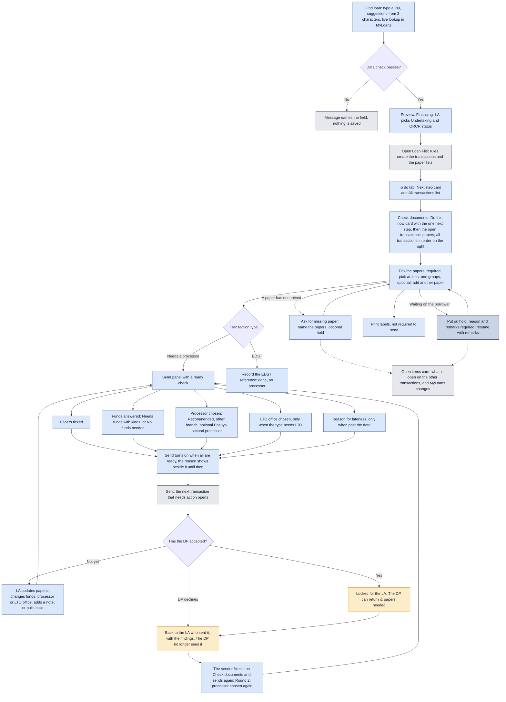
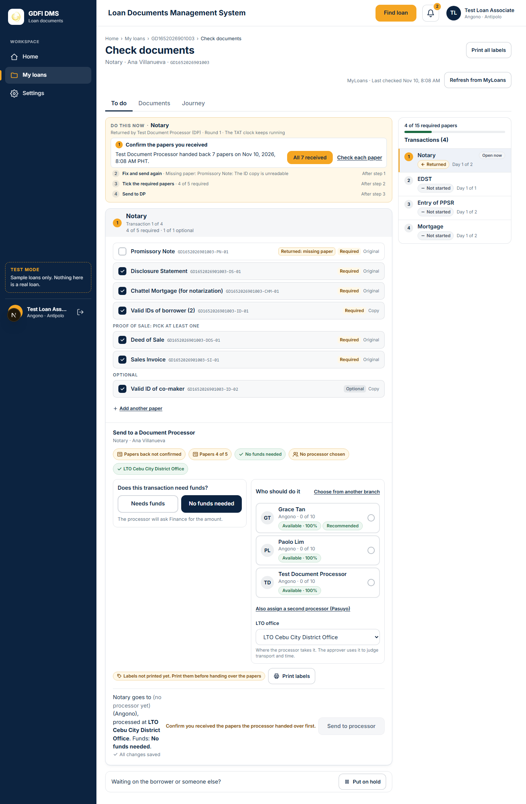
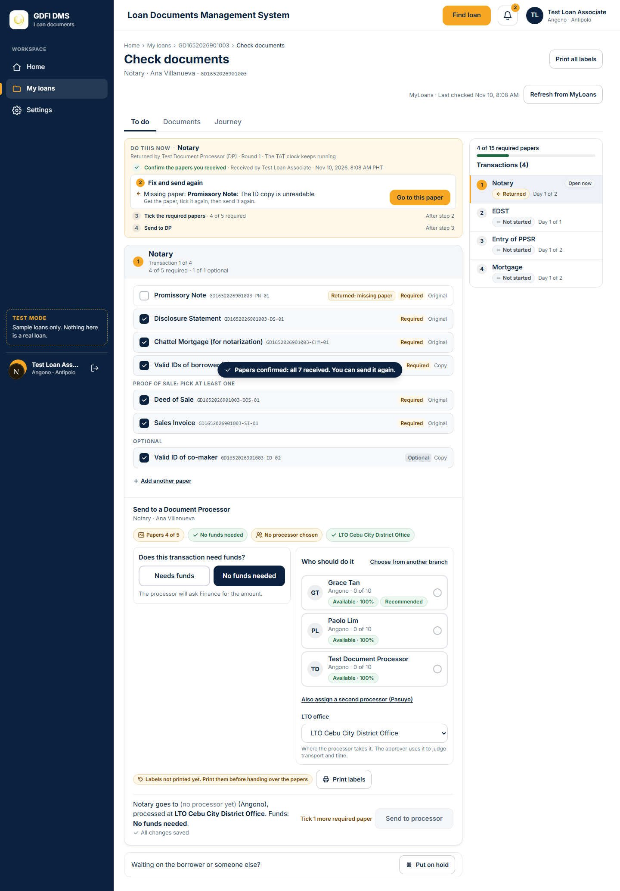
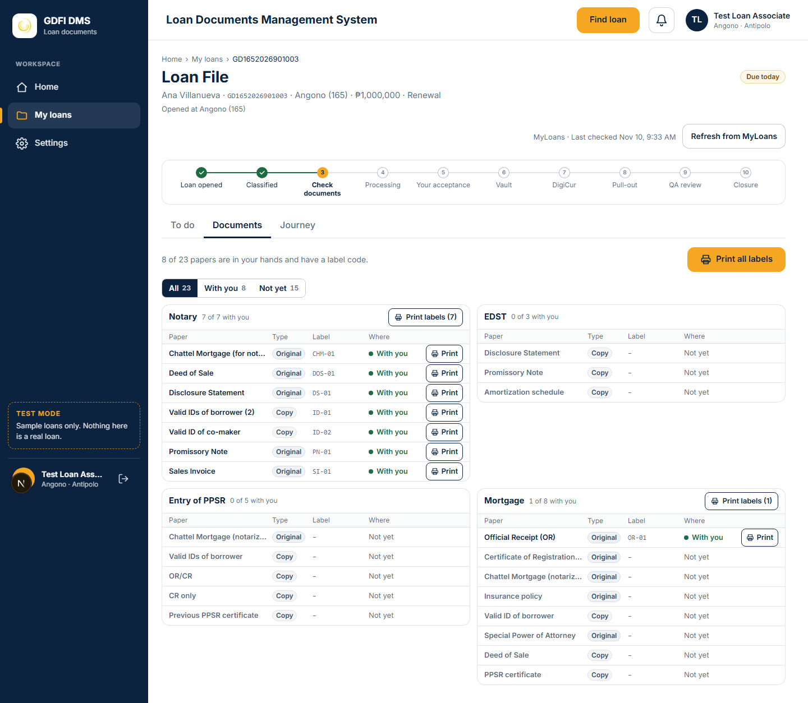
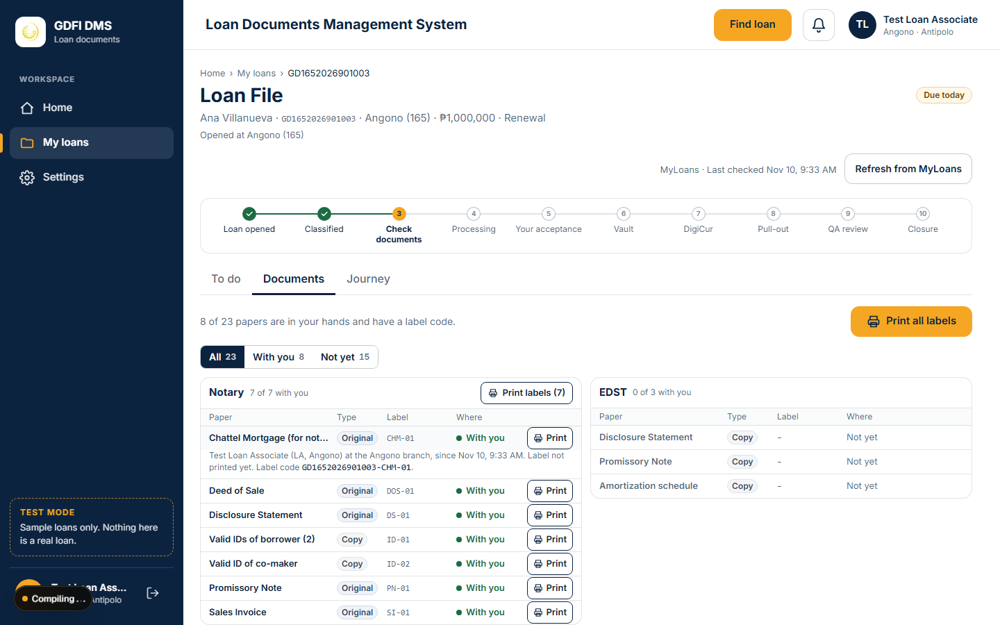
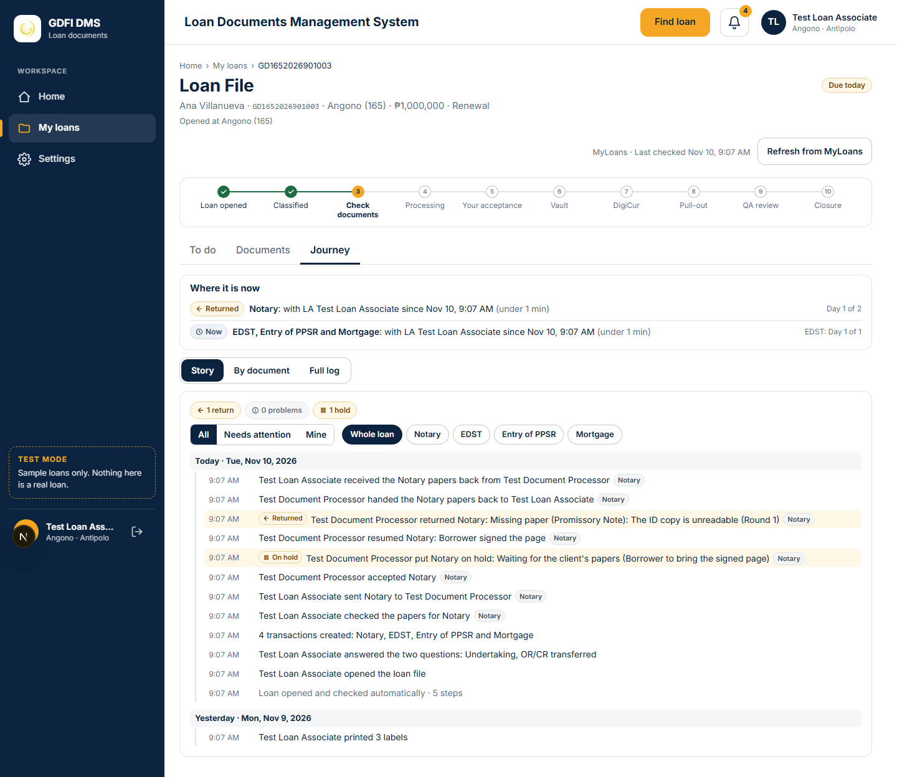
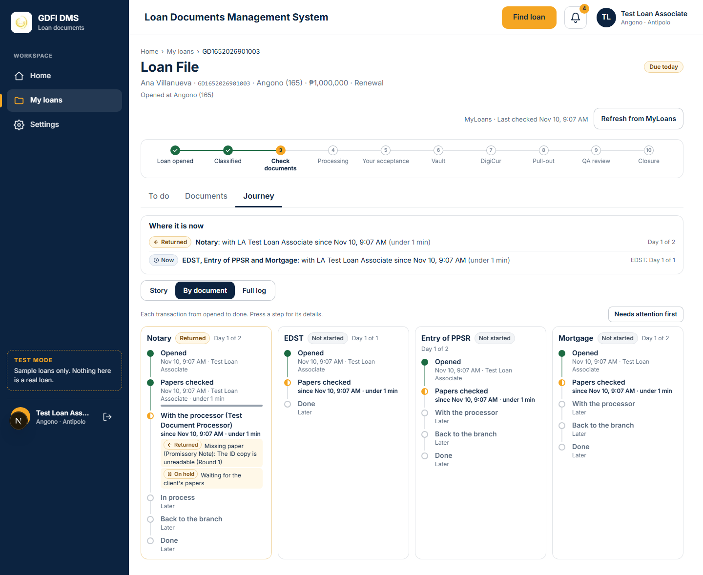

# The Loan Associate

What the Loan Associate does, from Find loan to Send and the changes allowed before the DP accepts.

Last updated: 10 November 2026 (PHT)

See the [colour key](README.md#colour-key).

- Find loan does a live lookup in MyLoans by PN; suggestions start at 3 characters; only loans in the user's branch access appear. The PN is checked first (Settings, System, PN format: GD + branch code + year + 9 + running number, for example GD1012026900001; spaces, dashes and dots are removed): a wrong PN shows "This does not look like a PN. Example: GD1012026900001" and the wrong part, and is never sent to MyLoans. The Loan File shows the PN as stored and "Opened at {branch} ({code})" under it ("..., now at ..." when MyLoans moved the loan).
- Check documents shows the "Do this now" card and the open transaction on the left, and all transactions, in fixed order, on the right (see [What the loan file shows first](#what-the-loan-file-shows-first)).
- Nothing is pre-selected for funds: the LA must answer. The LTO office and the late reason appear only when they apply.
- Before the DP accepts, the LA can update papers, change funds, processor or LTO office, add a note, or pull back. After accepting, only the DP can return it.
- A Decline (before accepting) or a Return to LA (after) goes back to the specific LA who sent it, never to another LA of the branch: it is on that LA's Home ("Sent back to you"); on Check documents the "Do this now" card says it once: the findings, the DP's name and the round. Sending again starts a new round; nothing is pre-selected.
- While a transaction is on hold it is locked for everyone (see [Locked](01-glossary.md)); only the hold owner can resume it.
- The Open items card on Check documents lists what is open on the other transactions of the loan file and MyLoans changes. What the "Do this now" card already says for the open transaction is not repeated there; when nothing is left, the card is not shown. A "Sent back to you" or "Waiting for papers" row reads top to bottom (the badge, the transaction, what was found or asked, then who and the date and time in PHT, so the turnaround time can be read exactly) and the whole row opens it (Open, or Show paper for a missing paper). The right column scrolls with the page. On the dashboard and the Updates page it is unchanged.

## What the loan file shows first

On Check documents, the "Do this now" card at the top of the left column says the one thing to do now on the open transaction. Each fact is said once. The steps come from one place (`getNextSteps` in `lib/workflow/next-steps.ts`), which also gives the status word in the Transactions list, the marker on a returned paper and what the Open items card leaves out, so they always agree. Only the steps that apply are shown; the first one not done is open, the others are one grey line ("After step 2") or a green tick when done.

1. **On hold**: the hold reason, who put it on hold, and Resume for the hold owner only (others see who must resume it). The transaction stays locked until then.
2. **Problem to fix**: the problem, who raised it, and its usual action.
3. **Confirm the papers you received**: after a Return to LA with papers handed over. "All 7 received" confirms them in one click; "Check each paper" opens the list of every paper, each set to Received, so one that did not arrive can be marked Not received (a problem is raised for it, as before).
4. **Fix and send again**: returned or declined by the DP. The findings are shown here once, with the paper named in bold and "Go to this paper". The paper's row in the checklist has one small marker ("Returned: missing paper"). It comes after step 3 because the paper must be back in hand before it can be fixed, and Send stays locked until the papers are confirmed.
5. **Waiting for a paper**: an open missing-paper request (not the DP's own return): which paper, who asked, "Show paper".
6. **Tick the required papers**: "4 of 5 required".
7. **Send to DP**: points to the Send panel, which keeps its own ready check. Work without a processor ends with EDST or Mark as done instead.

The card is soft amber for a returned transaction, soft red for a problem, soft grey-blue for a hold, and white with a plain border for normal work. The Transactions list shows one status word per transaction (On hold, Problem, Returned, Missing paper, Not started, Needs papers, Ready to send, Sent to DP, In progress, Coming back, Done) and the day count in grey. On tablet and phone the transactions become a strip under the card; only the strip scrolls sideways.

## Documents tab

The Documents tab lists every paper of the loan file, one compact card per transaction, in the usual order. It only shows; ticking papers stays on Check documents, and printing works as before.

- At the top: "8 of 23 papers are in your hands and have a label code", **Print all labels**, and the filter **All · With you · Not yet** with its counts. The filter is kept in the address (`?papers=with-you`), so a refresh keeps it; "Not yet" with nothing left says "All papers are with you."
- Each card: the transaction, "7 of 7 with you", and **Print labels (N)** for that card's papers (the same label page, with only those papers; hidden when none has a label).
- One line per paper: Paper, Type (Original or Copy), Label (the short code, for example `CHM-01`; the full code is in the tooltip and the details), Where (**With you** with a green dot, **Not yet** in grey, or a short phrase such as "At DP 1" or "On the way"), and **Print** when the paper has a label. "Not yet" lines are dimmed but keep their word.
- Press a line (or Enter) to open its details: who has it, where and since when, in Philippine time ("Test Loan Associate (LA, Angono) at the Angono branch, since Nov 10, 9:29 AM"), whether the label was printed, and the full label code. The same sentence is the line's tooltip.
- Two cards per row when the page is wide enough (1440), one column on a tablet, and on a phone collapsible cards (the ones with papers in hand open) with each paper on two lines and a full-size Print button.

## How to read the Journey

The Journey tab of the Loan File reads the same record three ways. Nothing is changed by reading it; the TAT clock never pauses.

- **Where it is now** (always on top): one line per place. Transactions in the same place and state share a line ("All 4 transactions: with LA 1 since Nov 9, 11:54 PM (7 h 30 min)"); one in another place or state gets its own line. Each line has one status pill (Now, On hold, Problem, Returned, Done) and the day count in grey ("Day 1 of 2", "Due today", or the late days in red). A role word and a name are said once ("With LA 1", never "With LA LA 1").
- **Story** (opens first): what happened, newest first. Each day is a date row ("Today · Tue, Nov 10, 2026", "Yesterday · Mon, Nov 9, 2026", then "Fri, Nov 7, 2026"); its events sit under it, each with its time (PHT) and one sentence ("DP 1 returned Notary: the ID copy is unreadable (Round 1)"), with the transaction pills. The same action by the same person in the same minute on several transactions is one line. Automatic steps are one grey line at the end of their day ("Loan opened and checked automatically · 5 steps"); they are listed in the Full log under **Show system steps**. Returns, declines, holds, problems and missing paper carry their word and a soft tint; the counts at the top are soft badges in the same colours ("1 return", "0 problems", "1 hold", "1 missing paper"; grey at 0), and pressing one shows only those lines. Filters: **All**, **Needs attention**, **Mine**, and **Whole loan** or one transaction.
- **By document**: one column per transaction (two per row on a tablet, a card per transaction on a phone, the ones that need attention open). Each goes Opened, Papers checked, With the processor (name), In process (only with stages), Back to the branch, Done: a filled dot when done (time, who, and a thin bar for the time it took), a gold half dot for now ("since Nov 9, 11:54 PM · 7 h 30 min"), an empty dot for later. Holds, returns, declines, problems, missing paper and funds show on the step they affected, with the Round for a return. Press a step to see its details. **Needs attention first** moves those columns to the front.
- **Full log**: the ten phases with every step, closed under "Full audit log". Search, **Who** (LA, DP, Finance, System), and the switches **Show system steps** and **Show not applicable** (both off at first). Each step says one phrase ("Done in 4 min · Nov 10, 8:42 AM", "Open since ..."); the target is named only when it is late or due today. Step numbers (1.1, 3.6) appear here only. "Papers: who has them" lists each paper's custody trail.

The choice of view and the filters are kept in the address, so a refresh keeps them.

[Back to the workflow index](README.md)
