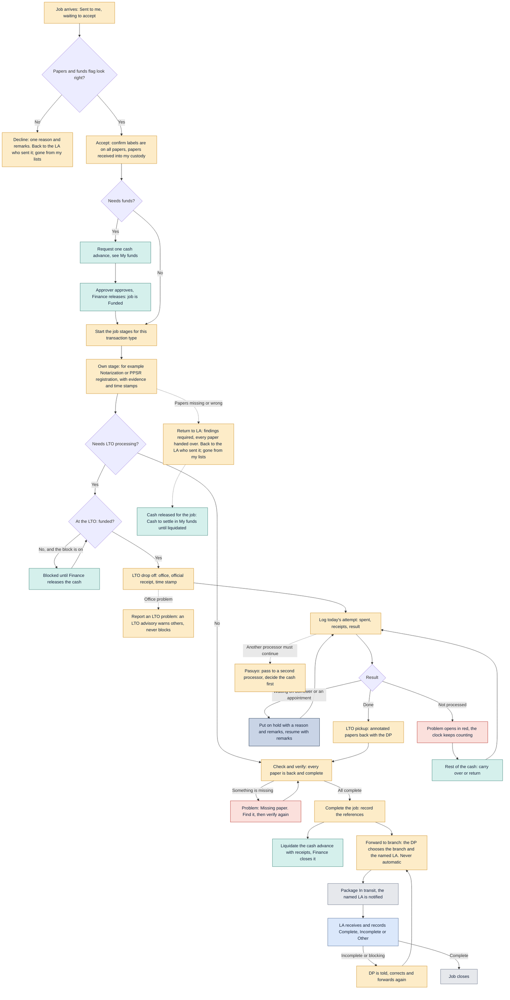

# One DP job

One Document Processor job, from arrival to the job closing at the branch.

Last updated: 9 November 2026 (PHT)

See the [colour key](README.md#colour-key).

- The job runs its type's stages in order (Settings, Processing stages). Each stage has Start and Finish; the times are the system's, nobody types them. Required evidence is checked on screen and on the server.
- LTO drop off and LTO pickup appear only when the transaction type has "Needs LTO processing" switched on. Starting LTO drop off is blocked until the job is funded when that setting is on.
- Attempts, holds and problems belong to the stage that is current when they are recorded.
- Check and verify is the last stage: the DP ticks every paper as received back and complete. A missing paper becomes a Problem (Missing paper) until found. Complete job and Forward stay blocked until it is done.
- Forwarding is manual and never automatic: the DP chooses the branch, then the named LA, and confirms the paper count. Liquidation runs beside forwarding and does not block it.
- The receiving LA records Complete, Incomplete or Other. Incomplete (or a blocking Other) sends the package back to the DP, who is told, corrects it and forwards again. The clock is never paused.
- Dotted lines (Return to LA, Pasuyo) can happen at any stage while the job is open. Pasuyo continues from the current stage.
- After a Decline or a Return to LA the job is no longer the DP's: it leaves every DP list, tile and count, the DP's notifications about it are removed, and an old link says "This job is no longer with you." If the LA sends it again it is a new round, possibly to another processor.
- While a job is on hold it is locked: nothing on it can change until the hold owner resumes it.
- At LTO drop off or LTO pickup the DP can press **Report an LTO problem** (System down, Office closed, Long queue, Other, with remarks). It warns the people choosing that office and the processors going there, and Operations is told; it never blocks anything. Active advisories for the job's office show in its "Process at" box. See [Monitoring](11-monitoring.md#lto-advisories).

[Back to the workflow index](README.md)
