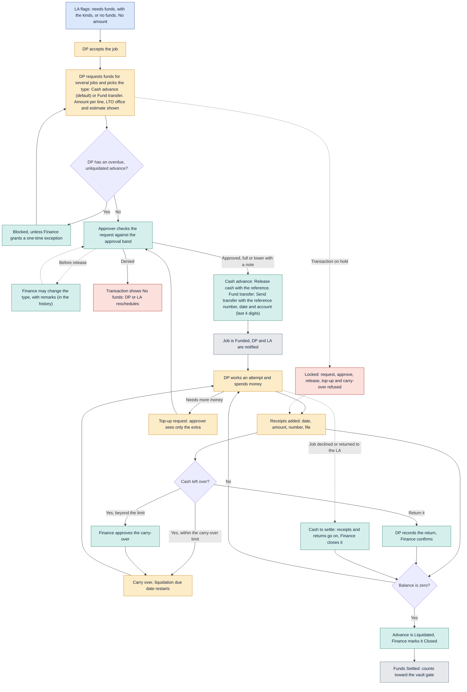

# Funds

How cash advances and fund transfers are flagged, requested, approved, released, carried over and liquidated.

Last updated: 9 November 2026 (PHT)

See the [colour key](README.md#colour-key).

- The LA only flags whether funds are needed. The DP asks for the amount, one advance for several jobs, and picks the funds type: Cash advance (default) or Fund transfer.
- Both types follow the same flow: approval bands, release, receipts, carry-over, top-up, liquidation, overdue notice, holds and permissions are the same. Only what Finance enters at release differs (Settings, Funds types), and a type's "Must be liquidated with receipts" switch (on for both by default).
- Finance can change the type before release, with remarks (5 to 500 characters); top-ups and carry-overs follow their record's type, and Finance can change a top-up's type at release.
- The type shows as a pill everywhere funds appear (My funds, the Finance lists, the job and loan transaction, Open items, notifications and emails, the TAT report and the CSV exports), with filters and counts by type on the Finance lists and the TAT report.
- The LTO office gives the approver an estimate of distance, time and transport.
- Carry-over is free for 3 business days by default, then Finance approves it. Liquidation is due 10 business days after release, restarting at each carry-over decision.
- Cash amounts are visible only to people with the permission `journey:view_amounts`.
- On a transaction that is on hold, Finance cannot request, approve, release, top up or approve a carry-over ("Locked: on hold by {name} since {date and time}."). Denying, receipts, returns, liquidation, close and exceptions stay allowed so money already out can be settled.
- When a job goes back to the LA after cash was released, the advance stays the DP's to settle ("Cash to settle"). A re-send asks for new cash like any new job.

[Back to the workflow index](README.md)
