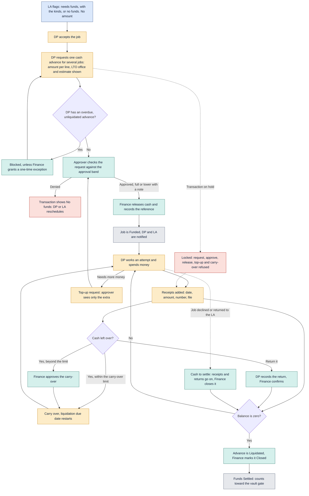

# Funds

How cash advances are flagged, requested, approved, released, carried over and liquidated.

Last updated: 8 November 2026 (PHT)

See the [colour key](README.md#colour-key).

- The LA only flags whether funds are needed. The DP asks for the amount, one advance for several jobs.
- The LTO office gives the approver an estimate of distance, time and transport.
- Carry-over is free for 3 business days by default, then Finance approves it. Liquidation is due 10 business days after release, restarting at each carry-over decision.
- Cash amounts are visible only to people with the permission `journey:view_amounts`.
- On a transaction that is on hold, Finance cannot request, approve, release, top up or approve a carry-over ("Locked: on hold by {name} since {date and time}."). Denying, receipts, returns, liquidation, close and exceptions stay allowed so money already out can be settled.
- When a job goes back to the LA after cash was released, the advance stays the DP's to settle ("Cash to settle"). A re-send asks for new cash like any new job.

[Back to the workflow index](README.md)
