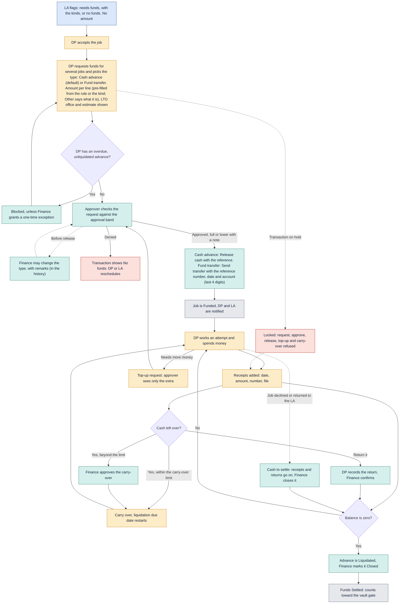
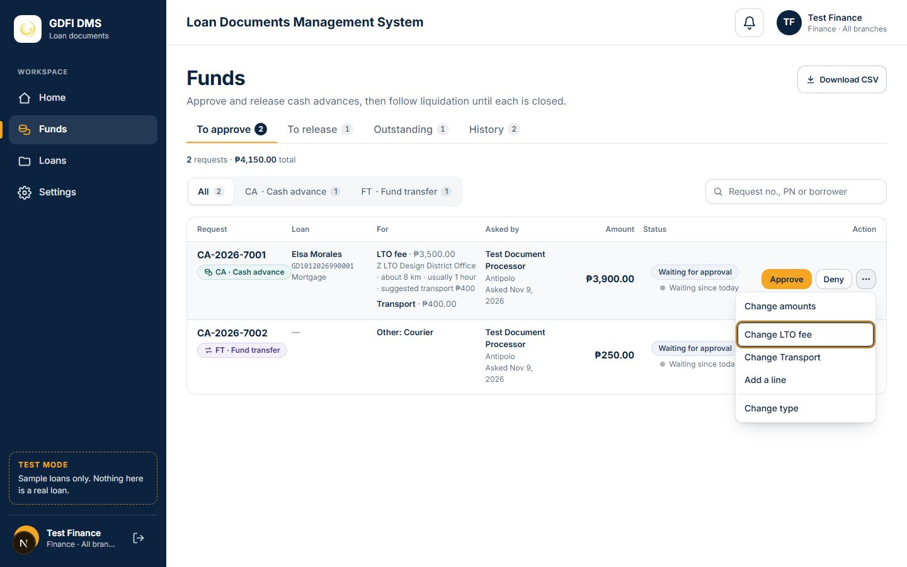
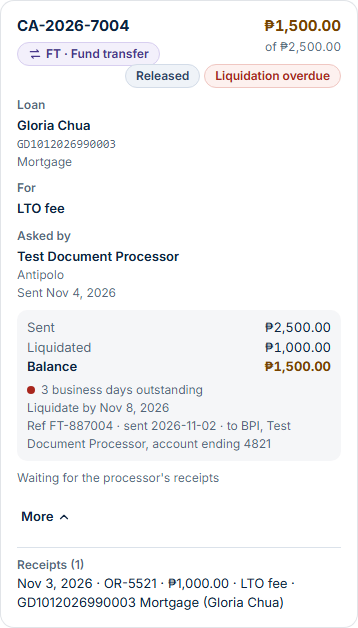

# Funds

How cash advances and fund transfers are flagged, requested, approved, released, carried over and liquidated.

Last updated: 9 November 2026 (PHT)

See the [colour key](README.md#colour-key).

- The LA only flags whether funds are needed. The DP asks for the amount, one advance for several jobs, and picks the funds type: Cash advance (default) or Fund transfer.
- Both types follow the same flow: approval bands, release, receipts, carry-over, top-up, liquidation, overdue notice, holds and permissions are the same. Only what Finance enters at release differs (Settings, Funds types), and a type's "Must be liquidated with receipts" switch (on for both by default).
- Finance can change the type before release, with remarks (5 to 500 characters); top-ups and carry-overs follow their record's type, and Finance can change a top-up's type at release.
- The type shows as a pill everywhere funds appear (My funds, the Finance lists, the job and loan transaction, Open items, notifications and emails, the TAT report and the CSV exports), with filters and counts by type on the Finance lists and the TAT report.
- The LTO office gives the approver an estimate of distance, time and transport.
- Expense kinds are a setting (Settings, Expense kinds; see [Glossary](01-glossary.md)): Notary fee, PPSR fee, LTO fee, Transport and any kind added later, then the built-in **Other**, always last. Inactive kinds are not offered for new requests or rules; old records keep them.
- Choosing **Other** needs "What is this expense?" (3 to 60 characters, with words, not only numbers or symbols). Send and Save stay off until it is typed, and the server refuses it too. It shows as "Other: Courier" everywhere, in its own "Other description" column in the CSV and in the Journey. Old Other lines without text show "Other (not described)" and are never blocked.
- The amount a line starts with: the LTO office's transport amount (Transport only), else the Cash-advance rule's Suggested amount for that transaction and kind, else the kind's own amount, else empty. Grey text under the field says where it came from ("Suggested by rule", "Preset for this kind"). A changed starting amount shows "Preset was ₱500.00". The rule's maximum and "more than the maximum needs a typed reason" apply as before, to typed and pre-filled amounts alike.
- A kind's amount is "Person enters it" (the default, and always for Other), "Suggested amount" (pre-filled, may be changed) or "Fixed amount" (pre-filled, read only for the processor; refused on the server if changed). On To approve, Finance or an approver with `funds:kinds_manage` may change a fixed amount for that one request; the history and the Journey say so. A fixed amount above a rule's maximum cannot be saved. Changing a kind's amount affects only new lines; every line keeps its amount, its source (rule, preset, typed) and whether it was locked, which are in the CSV and the Journey line.
- On To approve, Finance and approvers can change a line's kind, description and amount, or add a line, before the request is decided; the total follows the lines. "+ Add new kind" next to the Expense kind dropdown adds a kind (Active, selected at once, audited). Processors see the link only with `funds:kinds_manage`; otherwise they use Other with a description.
- Receipts (liquidation) always take the amount really spent, even for a kind with a fixed amount. Top-ups and receipts belong to an existing line, so its kind (and Other description) shows there; they do not ask for a kind again.
- In a Cash-advance rule, Other means "any kind that has no rule of its own" for that transaction: no description is asked there.
- Carry-over is free for 3 business days by default, then Finance approves it. Liquidation is due 10 business days after release, restarting at each carry-over decision.
- Cash amounts are visible only to people with the permission `journey:view_amounts`.
- On a transaction that is on hold, Finance cannot request, approve, release, top up or approve a carry-over ("Locked: on hold by {name} since {date and time}."). Denying, receipts, returns, liquidation, close and exceptions stay allowed so money already out can be settled.
- When a job goes back to the LA after cash was released, the advance stays the DP's to settle ("Cash to settle"). A re-send asks for new cash like any new job.

## How to read this page

The Funds page (Finance and approvers) has four tabs: To approve, To release, Outstanding and History. Each tab shows its count in a small pill, and under the tabs one grey line gives the number of requests shown and their total ("2 requests · ₱4,150.00 total"). The Type filter (All, CA, FT, with counts) and the search box (request number, PN or borrower) narrow the list; the search works on the page only, and the summary line follows both.

- **One request is one row.** Request (number and type pill), Loan (borrower, PN, transaction), For (expense kind, then the LTO office with its distance and time), Asked by (processor, branch, date), Amount (with the suggested amount when there is one), Status and Action. An empty field shows a grey dash.
- **To release** shows the approved amount and who approved it. **Outstanding** shows the money trail (released or sent, liquidated, returned, balance in amber while above zero) and the days outstanding with a dot and words: red when the liquidation is overdue, amber after 10 business days, grey otherwise. **History** shows the outcome (Closed, Denied, Cancelled) and its date, with no Action column.
- **Actions.** At most two small buttons per row on one line (the main one gold), then a three-dots button, "More actions", for the rest (change amounts, change a line or add one, change the type). The list opens beside the dots, upward near the bottom of the screen; arrow keys move through it and Esc closes it. On a phone the buttons are full width and the list is a bottom sheet. Approve approves the amounts as asked in one click; Deny and Change amounts open the full approve-or-deny form. Release (or Send for a transfer) opens the release form for the type. Receipts and the record's history open with the row's Details.
- **Print.** A liquidated request has Print beside Close advance on Outstanding, and a closed one has Print in its row on History (the Action column; a row without a report has none). It opens the liquidation report in the GDFI print format (A4): the logo and request number, who asked, approved and released it, the expenses (released, receipts, difference), each receipt, any returned cash, the totals with the balance, and signature lines for the processor, Finance and the approver, with one divider under the header (solid navy on screen, solid black on paper) and a footer "Printed by name, date and time (Philippine time)". A normal report fits one A4 page, the totals and signatures kept together. Printing changes nothing; anyone who can see the request can print it.
- **View only.** A person who cannot act on any row of a tab sees one grey line above the list naming the missing tick ("Approving needs the 'Approve cash advances' tick on your role."). When only some rows are blocked (their own request, another approval band), those rows show a lock with the reason.
- **Widths.** A wide screen shows a table with a sticky header. A tablet shows Request, Loan, Amount and Status, with a chevron that opens For and Asked by. A phone shows one card per request, with the buttons full width at the bottom. The page never scrolls sideways.

All screenshots (1440, 820 and 390 px) are in `docs/screenshots/funds-design/`.

[Back to the workflow index](README.md)
