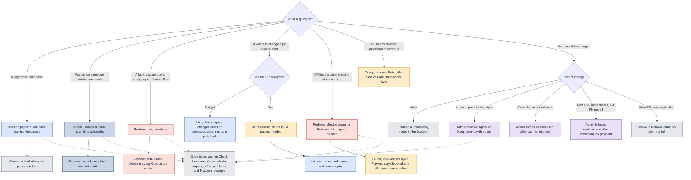

# When something goes wrong

Missing papers, holds, problems, changes after sending, Pasuyo and MyLoans changes.

Last updated: 8 November 2026 (PHT)

See the [colour key](README.md#colour-key).

[Back to the workflow index](README.md)
