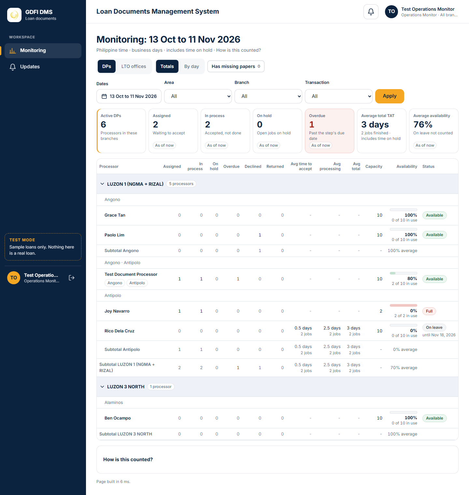
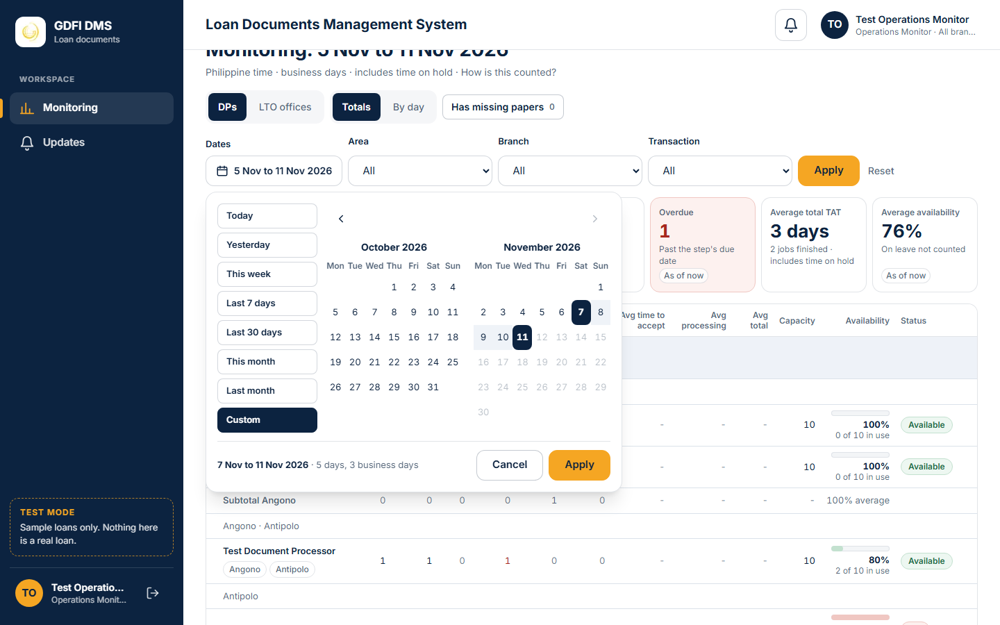
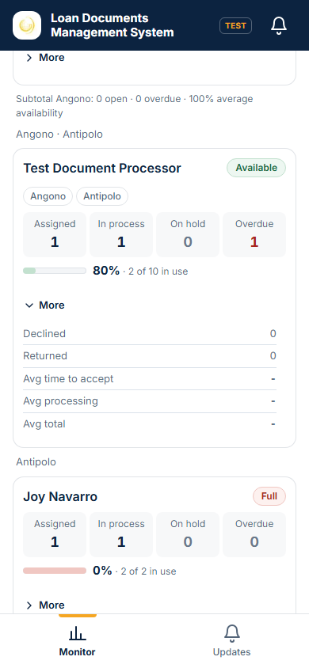
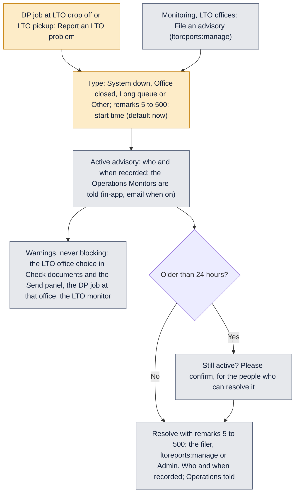

# Monitoring

How the Monitoring page counts processors (DPs) and LTO offices, and how LTO advisories work.

Last updated: 11 November 2026 (PHT)

The page is **Monitoring** in the sidebar, for people with `monitor:dp` (tab **DPs**) or `monitor:lto` (tab **LTO offices**). A monitor sees counts, times and PN lists only: a PN opens the loan file only for someone who may see loan files in that branch, and amounts show only with `journey:view_amounts`. The person's branch access applies; the Operations Monitor role sees all branches.

## How to read this page

The page is calm on purpose: the numbers are the same as before, only the layout changed (9 November 2026, design pass).

- **The top.** The title says the dates in words ("Monitoring: 11 Oct to 9 Nov 2026"); the grey line under it says Philippine time, business days and that times include time on hold. Two pairs of tabs (DPs or LTO offices; Totals or By day) use the same navy pill.
- **The date range.** One button with the range in words opens the presets (Today, Yesterday, This week, Last 7 days, Last 30 days, This month, Last month, Custom) and a two-month calendar (one month on a phone). Two clicked days make a Custom range; the picker says how many days and business days. Future days cannot be picked. Over 92 days, By day shows one row per week, and the picker says so. Apply keeps the range in the address (`range`, or `range=custom&from=…&to=…`), so the title and By day follow it and a shared link shows the same days. Esc or Cancel closes it.
- **Has missing papers.** The button beside the tabs shows how many loan files have a paper marked Missing (as of now, in the person's branches and the Area, Branch and Transaction filters; the dates do not apply). Pressed (`missing=1` in the address), the page lists those loan files, each paper with its transaction, reason and how many days it has been missing (calendar days, Philippine time), longest first. A PN opens the loan file for someone who may see it. There are no alerts and no emails for missing papers.
- **Filters.** Area, Branch and Transaction sit in one row with the gold Apply; **Reset** appears only when something is not at its default. On a phone they fold into a **Filters** button (with a count) that opens a bottom sheet; the date button stays next to it.
- **Tiles.** Big navy number, small label, one grey line; "As of now" marks today's counts. **Overdue** turns soft red and **On hold** soft amber only above 0. On a phone Overdue and Average availability come first.
- **The tables.** Each Area is a light navy band with its processor count and a chevron to fold it; branches are plain grey lines under it. Zero is a light grey 0; Overdue above 0 is red, On hold above 0 amber. An average shows "-" alone when no job finished. Availability is a small usage bar (jobs in use out of capacity; green Available, amber Busy, red Full, grey On leave) with "60%" and "2 of 5 in use". A branch subtotal shows only when the branch has more than one processor; the Area subtotal always shows. Click a name to open the processor's (or office's) jobs.
- **Widths.** 1024 px and wider: every column. 640 to 1023 px: Processor, Assigned, In process, On hold, Overdue, Availability and Status; **Details** under the name opens Declined, Returned and the three averages. Phones: one card per processor (or office, or day) with the four main numbers, the usage bar and **More**. The page never scrolls sideways.
- **States.** While numbers load, grey placeholders keep the layout still. A period with nothing finished, declined or returned (or no LTO transactions, or nothing by day) says "No jobs in this period. Try a wider date range." with a Last 30 days button. If the page fails to load, it says so with Retry.
- **By day.** Weekends and holidays are muted rows marked "Not a business day"; their counts still show (things can happen on a Saturday), but they are not business days for the turnaround times.

Screenshots (1440, 820 and 390 px) are in `docs/screenshots/monitoring-design/`: `dp-totals`, `dp-by-day`, `lto-totals`, `date-range-open`, `date-range-custom`, `empty-state`, plus `details-open-820`, `card-more-open-390` and `filters-sheet-390`.

## Rules that apply to every number

- **The TAT clock never pauses.** Every time on the page includes time on hold; the page says "Includes time on hold".
- **Business days**: weekends and the holidays in Settings are skipped, as for the turnaround times. The same day counts as 0 days; Friday to Monday is 1 day.
- **Philippine time** for every date and time.
- **Dates filter**: Today, Yesterday, Last 7 days, Last 30 days (the default), This month, Last month, or Custom (From and To, both days included, no future dates, To not before From). The chosen dates are in the heading ("9 Nov to 9 Nov 2026"). Finished jobs, averages, declines, returns, transactions at an office and advisories resolved use these dates.
- **As of now**: assigned, in process, on hold, overdue, availability and "at the LTO now" are always today's state, whatever the dates.
- **Area, Branch and transaction** filters apply to every count (a job belongs to the loan's branch; the Area filter keeps the jobs of any branch in that Area). Branches are listed by name only, for example "Antipolo", only those in the person's access; branches hidden from the DMS are not offered. A processor is listed when **any** of their branches is in the Area or is the Branch picked.
- **Totals / By day**: By day shows, for each day (each week, Monday to Sunday, when the range is over 92 days), what happened that day.

## DP monitor

| Word | Exactly what is counted |
|---|---|
| **Assigned** | Sent to the processor and not yet accepted. |
| **In process** | Accepted and not completed or forwarded. |
| **On hold** | The processor's open jobs with an active hold. Not counted again as assigned or in process. |
| **Open jobs** | Assigned + in process + on hold. |
| **Overdue** | Open, and the transaction's current step is past its due date (the same late rule as the TAT chips: business days used since the step began are more than its target). |
| **Declined / Returned** | Declined (before accepting) or returned to the LA (after accepting) by the processor, in the dates chosen. |
| **Time to accept** | Sent to accepted. |
| **Processing time** | Accepted to the processor finishing the job (Check and verify done). |
| **Total** | Sent to Check and verify done. |
| **Averages** | Over the jobs finished (Check and verify done) in the dates chosen, always with "n jobs". |
| **Capacity** | The processor's own number of open jobs, or the default (10, changed in Settings, Processor capacity, by `dpcapacity:manage`). |
| **Availability %** | max(0, capacity minus open jobs) divided by capacity, rounded, shown with the numbers: "60% · 4 of 10 in use". |
| **Status chip** | Available (40% or more), Busy (1% to 39%), Full (0%), On leave. One place in the code holds these thresholds. |
| **On leave** | A switch per processor with an optional last day. Counts as 0% available, is left out of the "Average availability" tile, is never recommended and is shown disabled in the Send panel ("On leave until {date}"). A past last day ends the leave by itself. |

A job passed to a second processor (Pasuyo) counts for the second processor once accepted; assigned, declined and time to accept stay with the processor it was sent to.

**Grouping: Area, then Branch.** The Area is the MyLoans Area of the processor's branches (for example "LUZON 1 (NGMA + RIZAL)").

- A processor whose branches are all in one Area is under that Area, and inside it under their branch ("Antipolo"), or under one line naming all their branches when they have several in that Area ("Angono · Antipolo"; more than three: "5 branches").
- A processor with branches in more than one Area is under the group **Several areas** (shown last).
- Every branch of the processor shows as a chip on their row.
- Each processor is in exactly one Area group and one branch line, so nobody is counted twice: the branch subtotals add up to the Area subtotal, and the Area subtotals add up to the totals.
- Each Area has a subtotal (and each branch line too when the Area has more than one); an Area can be collapsed. By day groups by Area the same way.

**Example.** Rico and Joy work only at Antipolo (101), Paolo and Grace only at Angono (165), and the test DP at both; all three branches are in LUZON 1 (NGMA + RIZAL). The Area LUZON 1 (NGMA + RIZAL) has three lines: "Angono" (Paolo, Grace), "Angono · Antipolo" (the test DP) and "Antipolo" (Rico, Joy). A processor of Antipolo (101) and Alaminos (390, LUZON 3 NORTH) is under Several areas, once. Filtering on LUZON 3 NORTH keeps that processor (one of their branches is there) and Ben of Alaminos, and only the jobs of LUZON 3 NORTH loans.

**Example.** DP 2 finished two jobs in the last 30 days. Job A was sent on Monday, accepted on Tuesday and finished the next Monday: time to accept 1 day, processing 4 days, total 5 days. Job B was sent, accepted and finished within two days: 0, 1 and 1. The row shows "Avg time to accept 0.5 days · 2 jobs", "Avg processing 2.5 days · 2 jobs", "Avg total 3 days · 2 jobs". DP 2 has 8 open jobs and the default capacity: "20% · 8 of 10 in use", Busy.

**Drill-down:** a processor's open jobs (PN, transaction, status, age in business days since sent, due date) and the declined and returned of the period.

**CSV:** switched off for now (11 November 2026): there is no Download CSV on this page.

**Send panel:** each processor shows the availability chip and "{open} of {capacity}". Full processors stay selectable with a warning; a processor on leave is shown disabled. Sending to a processor on leave is also refused on the server.

## LTO monitor

| Word | Exactly what is counted |
|---|---|
| **Transactions** | Jobs whose LTO drop off was done at the office in the dates chosen. |
| **At the LTO now** | LTO drop off done, LTO pickup not done, on an open job. |
| **Avg time at the LTO** | LTO drop off done to LTO pickup done, for jobs picked up in the dates chosen, in business days with "n jobs". |
| **Active advisories** | How many, and the latest. |
| **Estimated travel cash** | Only with `journey:view_amounts`: the office's suggested transport (Settings, LTO offices) times its transactions. |
| **Actual spent** | Only with `journey:view_amounts`: the spends logged on Transport lines of funds records for that office, on attempt days in the dates chosen. |
| **Busiest office** | The most transactions in the dates chosen. |

**Grouping:** by the office's area (its city in Settings, LTO offices), with subtotals. (LTO offices are not branches: they keep their own city grouping.) **Drill-down:** the office's jobs at the LTO now and picked up in the period (PN, transaction, processor, drop off, pickup, days). **By day:** drop offs, pickups and advisories filed each day.

## LTO advisories

- The warning reads "{office}: System down, reported by {name}, 2 h ago".
- Advisories are not part of any loan's Journey, and processors are not notified.
- People with `ltoreports:manage` (and the filer) can also change the type and remarks of an active advisory.
- Advisories do not end by themselves (see the open questions).

[Back to the workflow index](README.md)
