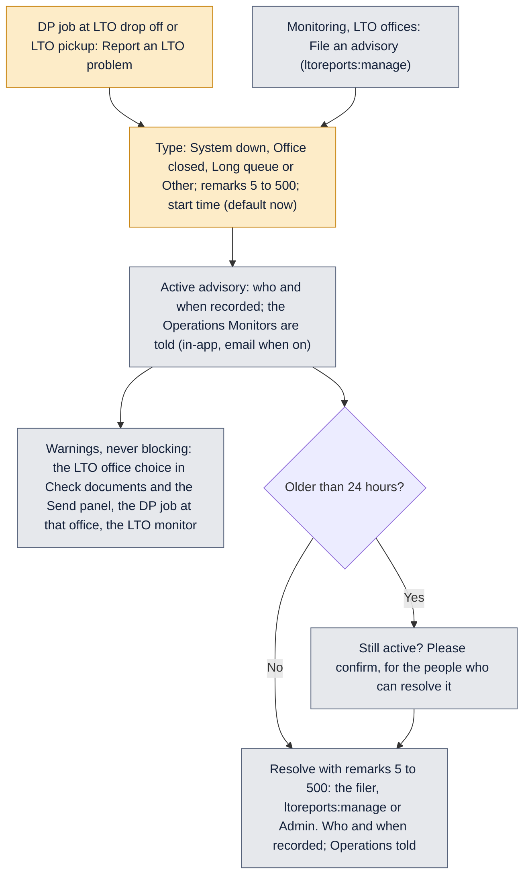

# Monitoring

How the Monitoring page counts processors (DPs) and LTO offices, and how LTO advisories work.

Last updated: 9 November 2026 (PHT)

The page is **Monitoring** in the sidebar, for people with `monitor:dp` (tab **DPs**) or `monitor:lto` (tab **LTO offices**). A monitor sees counts, times and PN lists only: a PN opens the loan file only for someone who may see loan files in that branch, and amounts show only with `journey:view_amounts`. The person's branch access applies; the Operations Monitor role sees all branches.

## Rules that apply to every number

- **The TAT clock never pauses.** Every time on the page includes time on hold; the page says "Includes time on hold".
- **Business days**: weekends and the holidays in Settings are skipped, as for the turnaround times. The same day counts as 0 days; Friday to Monday is 1 day.
- **Philippine time** for every date and time.
- **Dates filter**: Today, Yesterday, Last 7 days, Last 30 days (the default), This month, Last month, or Custom (From and To, both days included, no future dates, To not before From). The chosen dates are in the heading ("9 Nov to 9 Nov 2026"). Finished jobs, averages, declines, returns, transactions at an office and advisories resolved use these dates.
- **As of now**: assigned, in process, on hold, overdue, availability and "at the LTO now" are always today's state, whatever the dates.
- **Branch and transaction** filters apply to every count (a job belongs to the loan's branch).
- **Totals / By day**: By day shows, for each day (each week, Monday to Sunday, when the range is over 92 days), what happened that day. The CSV follows the view on screen.

## DP monitor

| Word | Exactly what is counted |
|---|---|
| **Assigned** | Sent to the processor and not yet accepted. |
| **In process** | Accepted and not completed or forwarded. |
| **On hold** | The processor's open jobs with an active hold. Not counted again as assigned or in process. |
| **Open jobs** | Assigned + in process + on hold. |
| **Overdue** | Open, and the transaction's current step is past its due date (the same late rule as the TAT chips: business days used since the step began are more than its target). |
| **Declined / Returned** | Declined (before accepting) or returned to the LA (after accepting) by the processor, in the dates chosen. |
| **Time to accept** | Sent to accepted. |
| **Processing time** | Accepted to the processor finishing the job (Check and verify done). |
| **Total** | Sent to Check and verify done. |
| **Averages** | Over the jobs finished (Check and verify done) in the dates chosen, always with "n jobs". |
| **Capacity** | The processor's own number of open jobs, or the default (10, changed in Settings, Processor capacity, by `dpcapacity:manage`). |
| **Availability %** | max(0, capacity minus open jobs) divided by capacity, rounded, shown with the numbers: "60% · 4 of 10 in use". |
| **Status chip** | Available (40% or more), Busy (1% to 39%), Full (0%), On leave. One place in the code holds these thresholds. |
| **On leave** | A switch per processor with an optional last day. Counts as 0% available, is left out of the "Average availability" tile, is never recommended and is shown disabled in the Send panel ("On leave until {date}"). A past last day ends the leave by itself. |

A job passed to a second processor (Pasuyo) counts for the second processor once accepted; assigned, declined and time to accept stay with the processor it was sent to.

**Grouping:** by the processor's branches. A processor of one branch is under that branch; a processor of two branches is under one group naming both ("Cebu · Quezon City"), so nobody is counted twice. Each group has a subtotal and can be collapsed.

**Example.** DP 2 finished two jobs in the last 30 days. Job A was sent on Monday, accepted on Tuesday and finished the next Monday: time to accept 1 day, processing 4 days, total 5 days. Job B was sent, accepted and finished within two days: 0, 1 and 1. The row shows "Avg time to accept 0.5 days · 2 jobs", "Avg processing 2.5 days · 2 jobs", "Avg total 3 days · 2 jobs". DP 2 has 8 open jobs and the default capacity: "20% · 8 of 10 in use", Busy.

**Drill-down:** a processor's open jobs (PN, transaction, status, age in business days since sent, due date) and the declined and returned of the period.

**Send panel:** each processor shows the availability chip and "{open} of {capacity}". Full processors stay selectable with a warning; a processor on leave is shown disabled. Sending to a processor on leave is also refused on the server.

## LTO monitor

| Word | Exactly what is counted |
|---|---|
| **Transactions** | Jobs whose LTO drop off was done at the office in the dates chosen. |
| **At the LTO now** | LTO drop off done, LTO pickup not done, on an open job. |
| **Avg time at the LTO** | LTO drop off done to LTO pickup done, for jobs picked up in the dates chosen, in business days with "n jobs". |
| **Active advisories** | How many, and the latest. |
| **Estimated travel cash** | Only with `journey:view_amounts`: the office's suggested transport (Settings, LTO offices) times its transactions. |
| **Actual spent** | Only with `journey:view_amounts`: the spends logged on Transport lines of funds records for that office, on attempt days in the dates chosen. |
| **Busiest office** | The most transactions in the dates chosen. |

**Grouping:** by the office's area (its city in Settings, LTO offices), with subtotals. **Drill-down:** the office's jobs at the LTO now and picked up in the period (PN, transaction, processor, drop off, pickup, days). **By day:** drop offs, pickups and advisories filed each day.

## LTO advisories

- The warning reads "{office}: System down, reported by {name}, 2 h ago".
- Advisories are not part of any loan's Journey, and processors are not notified.
- People with `ltoreports:manage` (and the filer) can also change the type and remarks of an active advisory.
- Advisories do not end by themselves (see the open questions).

[Back to the workflow index](README.md)
